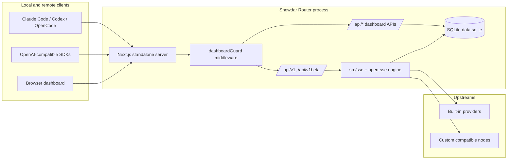
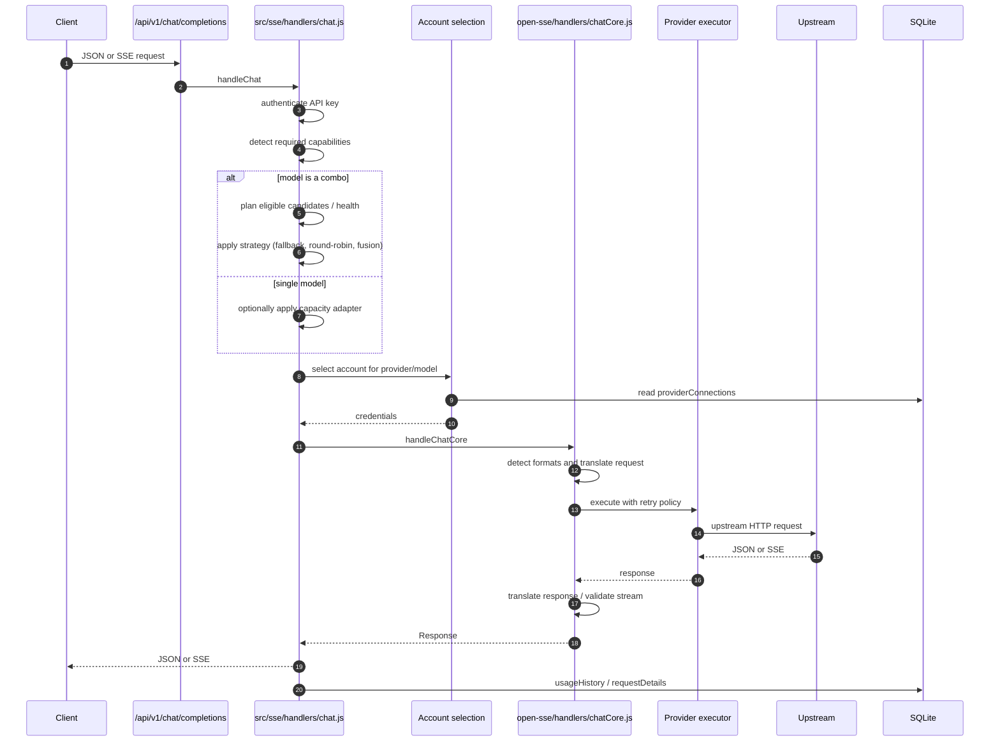

# Showdar Router Architecture

_Last updated: 2026-10-21_

This document describes the architecture that exists in this repository. The
code and tests are authoritative; this page is a map, not a specification for
behavior that has not been implemented.

## 1. Purpose and boundaries

Showdar Router is a local AI gateway and dashboard. It exposes an
OpenAI-compatible HTTP surface, translates requests and responses between
provider formats, routes each request across models and accounts, and records
local usage. The gateway runs as one Next.js process. The npm launcher in
`cli/` starts and manages that process.

In scope:

- local gateway runtime and dashboard;
- OpenAI-compatible and Anthropic-compatible API surfaces;
- provider authentication, account selection, token refresh, and retries;
- model combos, fallback, round-robin, and fusion;
- route health, cooldowns, and request cancellation;
- SSE streaming, stream validation, and usage persistence.

Out of scope:

- the upstream providers themselves;
- a hosted control plane or multi-tenant service;
- provider SLAs;
- external CLI binaries (Claude Code, Codex, OpenCode, etc.).

## 2. Runtime topology



### Gateway and CLI are separate artifacts

There are two independently built and versioned artifacts in one repository:

| Artifact | Location | Purpose |
|---|---|---|
| Gateway | repository root (`package.json`) | Next.js app, dashboard, routing engine, SQLite persistence |
| CLI launcher | `cli/` (`cli/package.json`) | `showdar-router` binary that starts and manages the gateway |

The gateway is built with `npm run build` into `.next/standalone` and started
with `node custom-server.js --port 21298` (or `npm start`). The CLI is packed
and published separately with `npm --prefix cli run pack:cli` and
`npm --prefix cli run publish:cli`. A gateway version and a CLI version may
differ; do not assume they are coupled.

## 3. Persistence

### Location and ownership

All runtime state lives under `DATA_DIR`:

```text
SHOWDAR_ROUTER_DATA_DIR  (highest priority)
DATA_DIR
~/.showdar-router        (default; %APPDATA%\showdar-router on Windows)
```

The primary database is:

```text
${DATA_DIR}/db/data.sqlite
```

It is opened in WAL mode. The database layer is owned by `src/lib/db/`; the
rest of the app goes through repository functions rather than opening SQLite
directly.

Use one router process per `DATA_DIR`. SQLite provides file locking and a
5-second busy timeout, but the application makes no multi-writer guarantees.

### Driver fallback

`src/lib/db/driver.js` selects the first available adapter:

| Runtime | Order |
|---|---|
| Bun | `bun:sqlite` → `sql.js` |
| Node | `better-sqlite3` → `node:sqlite` (Node >= 22.5) → `sql.js` |

If every adapter fails, startup fails with
`No SQLite driver available`. The CLI installs native SQLite runtime packages
under `${DATA_DIR}/runtime` rather than inside the globally installed CLI
package.

### Schema

The declarative schema is in `src/lib/db/schema.js` (`SCHEMA_VERSION = 1`).
Tables:

- `_meta` — schema version and migration metadata.
- `settings` — one row (`id = 1`) containing a JSON settings document.
- `providerConnections` — provider accounts and credentials.
- `providerNodes` — custom OpenAI/Anthropic-compatible endpoints.
- `proxyPools` — outbound proxy pools.
- `apiKeys` — router API keys.
- `combos` — named ordered model lists and optional `kind`.
- `kv` — scoped key/value state (model aliases, custom models, pricing,
  disabled models, route health).
- `usageHistory` — per-request usage records.
- `usageDaily` — daily aggregates.
- `requestDetails` — optional sanitized request-detail records.

Migrations are additive where possible. A schema-version change triggers a
pre-change backup under `${DATA_DIR}/db/backups/`.

### Legacy files are import sources only

Older installations used JSON files. They are imported once, then left in
place as historical data:

| Legacy file | Imported into |
|---|---|
| `db.json` | settings, connections, nodes, pools, keys, combos, `kv` scopes |
| `usage.json` | `usageHistory`, `usageDaily`, lifetime counter |
| `disabledModels.json` | `kv` scope `disabledModels` |
| `request-details.json` | `requestDetails` |

After migration, runtime reads and writes go to SQLite. `src/lib/usageDb.js` is
a compatibility shim that re-exports the SQLite repositories; there is no
separate live `usage.json` or rolling `log.txt` store. Deleting `data.sqlite`
can cause the legacy files to be imported again because a marker records
whether the one-time import completed.

## 4. Public HTTP surface

`next.config.mjs` rewrites root-level compatibility paths into app routes:

| Public path | Internal route |
|---|---|
| `/v1/*` | `/api/v1/*` |
| `/v1` | `/api/v1` |
| `/v1beta/*` | `/api/v1beta/*` |
| `/codex/*` | `/api/v1/responses` |
| `/responses` | `/api/v1/responses` |

Key routes under `src/app/api/v1/`:

- `chat/completions`
- `messages` and `messages/count_tokens`
- `responses` and `responses/compact`
- `models`, `models/info`, `models/[...model]`
- `embeddings`
- `images/generations`
- `audio/speech`, `audio/transcriptions`, `audio/voices`
- `videos/generations`, `videos/edits`, `videos/extensions`, `videos/[id]`
- `search`
- `web/fetch`
- `api/chat` compatibility route

`v1beta` exposes Gemini-style model routes.

### Authentication boundary

`src/proxy.js` delegates to `src/dashboardGuard.js`.

- LLM API prefixes (`/v1`, `/v1beta`, `/api/v1`, `/api/v1beta`, `/codex`,
  `/responses`) are middleware-public, but remote access requires a valid
  router API key or the local CLI token. Chat handlers separately enforce the
  `requireApiKey` setting (default `true`), so a client API key is still
  required for chat requests unless that setting is disabled.
- Dashboard `/api/*` routes are deny-by-default. A valid dashboard session or
  the CLI token is required. A small allow-list (`/api/health`, `/api/init`,
  login/status routes, etc.) is public.
- `requireLogin` defaults to `true`.
- Spawn-capable or host-secret routes are restricted to loopback/CLI-token
  callers.
- Provider credentials are stored in SQLite. Protect the data directory as a
  secret: it contains API keys and OAuth tokens.

## 5. Configuration model

### Provider nodes, providers, and accounts

- **Provider node** (`providerNodes`): a custom endpoint definition (for
  example an OpenAI-compatible or Anthropic-compatible server). It carries a
  name, prefix, API type, and base URL. Its prefix becomes a model namespace.
- **Provider** (`provider` field on connections): either a built-in provider
  ID from the registry (`openai`, `anthropic`, `gemini-cli`, `antigravity`,
  etc.) or a custom node prefix.
- **Account / connection** (`providerConnections`): one credential set for a
  provider. It stores auth type, priority, active flag, tokens/API key, test
  status, and per-account rate-limit state. Multiple accounts for one provider
  are tried in priority order; failures can cool down or lock one account
  without disabling the provider.
- Some built-in free providers are `noAuth`; credential selection synthesizes
  a virtual `Public` connection instead of reading a stored account.

### Combos

A combo (`combos` table) is a named ordered list of model strings. A request
whose `model` matches a combo name is routed through the combo layer instead
of a single provider/model pair.

Strategy selection, in order:

1. per-combo `settings.comboStrategies[comboName].fallbackStrategy`;
2. global `settings.comboStrategy`;
3. default `"fallback"`.

Supported strategies: `fallback`, `round-robin`, `fusion`. Fusion can also
configure a `judgeModel` and `fusionTuning` per combo.

`settings.comboStickyRoundRobinLimit` controls how many consecutive requests a
round-robin combo stays on one primary model before rotating. Rotation state
is in memory and resets on process restart.

### Settings

Settings live in the single `settings` row and are merged with defaults in
`src/lib/db/repos/settingsRepo.js`. Important keys:

- `requireLogin`, `requireApiKey`
- `comboStrategy`, `comboStrategies`, `comboStickyRoundRobinLimit`
- `capacityAdapter` (per-capability pools; see below)
- `providerStrategies`
- `cloudEnabled` / tunnel settings (optional integrations, disabled by default)

## 6. Request lifecycle (`POST /v1/chat/completions`)



Failure handling happens at three layers:

1. **Executor retries** — retry the same URL/account for configured statuses.
2. **Account fallback** — exclude the failed account and select another for
   the same provider/model.
3. **Combo/fusion fallback** — advance to the next model candidate.

## 7. Routing strategies

### Ordered fallback

Candidates are tried in the configured order. Capability planning may reorder
or drop hard-incompatible candidates before dispatch. The first candidate that
returns a valid response wins; a successful-but-empty chat stream is treated
as a failure and does not win.

### Round-robin

Round-robin uses the same eligible candidate set, but chooses a primary based
on per-combo rotation state and the sticky limit. The selected primary is
committed only when it is actually attempted; the remaining eligible
candidates stay available as fallback. State is process-local.

### Fusion

Fusion fans out a request to multiple panel models in parallel and then asks a
judge model to synthesize one answer.

- Panel calls are non-streaming and run with `tools`/`tool_choice` removed;
  tool history is flattened to prose so panel models do not emit tool calls.
- The stream option is removed from panel requests and `stream: false` is
  forced.
- If exactly one panel answer survives, it is replayed directly without a
  judge.
- If no panel answer survives, the request fails with 503 (or a retry hint
  when upstream reset metadata exists).
- A judge failure falls through to other panel models as judge candidates.

### Capability planning and the capacity adapter

Hard capabilities are input modalities: `vision`, `pdf`, `audioInput`,
`videoInput`. A candidate that cannot accept a hard capability is removed
rather than allowed to silently strip user data. Soft capabilities (for
example `search`) only reorder candidates.

The **capacity adapter** is a global fallback pool per hard capability. When
none of the original candidates can satisfy a required capability, pool models
that do satisfy it are prepended as priority candidates; the originals remain
as fallback. Pool models also get history trimming to fit their context
window.

Defaults in `settingsRepo`:

- `vision`: enabled, no models configured;
- `audioInput`: enabled, no models configured;
- `pdf`, `videoInput`: disabled.

An enabled pool with an empty `models` list is not a no-op: it falls back to
the built-in `oc/mimo-v2.5-free` model. `oc` is the OpenCode Free provider,
declared `noAuth: true` with base URL `https://opencode.ai`. This means default
vision/audio requests that no configured model can handle may be sent to a
remote third-party service. See `docs/OPERATOR-RUNBOOK.md` for opt-out
instructions.

## 8. Health, cooldown, and half-open

Route health is tracked per model string by `RouteHealthState`
(`open-sse/services/routeHealthState.js`) and persisted in the `kv` scope
`routeHealth`. It is independent of account-level rate limits.

Before an attempt, routing calls `beforeModelAttempt`:

- If the route's `nextProbeAt` is in the future, the candidate is skipped and
  the reason is recorded.
- Once the deadline passes, the route is treated as half-open. The first
  caller takes a 10-minute probe lease; other callers skip while the lease is
  held. Only the lease owner may clear or replace the state.
- A successful probe clears the route record; a failed probe records a new
  cooldown.

Cooldown state and windows are configured in
`open-sse/config/errorConfig.js`:

| Reason | Base window | Maximum window |
|---|---|---|
| `quota`, `transient_rate_limit` | 30 s | 15 min |
| `daily_quota` | 6 h | 24 h |
| `subscription` | 30 min | 60 min |
| `authentication` | 5 min | 15 min |
| `capability`, `unsupported_model`, `model_not_found` | 10 min | 30 min |
| `provider_capacity`, `stream_aborted` | 15 s | 2 min |
| `network` | 30 s | 5 min |
| `timeout` | 60 s | 10 min |
| `unknown` | 30 s | 2 min |

Explicit upstream `Retry-After`/reset metadata is authoritative within the
policy ceiling, except that quota-family deadlines can use the longer metadata
ceiling. Account-level cooldowns (`rateLimitedUntil`, model locks) are separate
and can outlive a route cooldown.

A route may be `cooldown` or `open`; both cause skips until `nextProbeAt`.
Half-open probes allow recovery without a restart.

## 9. Retries, timeouts, and cancellation

### Executor retries

Defaults from `open-sse/config/runtimeConfig.js`:

| Status | Attempts | Delay |
|---|---|---|
| 429 | 0 | 0 |
| 502 | 3 | 3000 ms |
| 503 | 3 | 2000 ms |
| 504 | 2 | 3000 ms |

Provider-specific overrides can replace these. When a usable combo fallback
candidate remains, capacity failures use short overrides (503: no retry;
502/504: one retry) so the router advances instead of burning the per-candidate
budget.

Deterministic failures (unsupported model, capability rejection, invalid
credentials, context overflow, etc.) are not retried on the same URL; they are
classified and handed to account/combo fallback.

### Phase timeouts

| Phase | Default | Environment variable |
|---|---|---|
| Upstream response headers (connect) | 60 s | `FETCH_CONNECT_TIMEOUT_MS` |
| First stream chunk / prefill | 200 s | `STREAM_FIRST_CHUNK_TIMEOUT_MS` |
| Inter-chunk stall | 360 s | `STREAM_STALL_TIMEOUT_MS` |
| Combo first meaningful output | 30 s | `COMBO_FIRST_MEANINGFUL_TIMEOUT_MS` |
| Upstream error-body read | 5 s | `ERROR_BODY_READ_TIMEOUT_MS` |

There is no single end-to-end request deadline. Timeouts are per phase and
retry budgets are per candidate; an operator must reason about the combination.

### Cancellation

The client request `AbortSignal` is propagated through account selection, the
executor, retries, stream validation, and fusion panels. A client abort returns
499 where a response is still possible, cancels panel work, and stops further
candidate/account dispatch. Stream cleanup aborts the upstream request after a
short grace period and releases readers/timers.

## 10. Streaming contract

### How streaming is chosen

`chatCore` decides whether to request an upstream stream from:

- `body.stream === true` → streaming;
- `body.stream === false` → JSON, unless the provider is marked
  `forceStream`;
- no `stream` field and no client `Accept` preference → the internal decision
  is streaming (`body.stream !== false`);
- `Accept: application/json` without `text/event-stream` and no explicit
  `stream: true` → JSON.

Some providers force streaming regardless of the client request (for example
`oc` with `forceStream: true`). Their responses are translated back to the
client's requested shape where supported.

**Known contract gap:** when `stream` is omitted, the internal decision is
streaming, but the request forwarded to an OpenAI-compatible target may still
omit the `stream` field. The router sends `Accept: text/event-stream` while the
upstream may return JSON. Combo routes can then fail with HTTP 502; direct
routes can return an SSE content type with a JSON body. This is documented as
Risk A in the SR-08 release report. Clients should send `stream: true` or
`stream: false` explicitly.

### Validation before commitment

Combo and fusion successes are validated before the response is handed to the
client:

- A non-SSE JSON success must contain meaningful content, reasoning, or tool
  calls.
- An SSE success must produce a first meaningful delta (content, reasoning,
  `tool_calls`, or `function_call`) within 30 seconds. Empty keep-alives and
  `[DONE]` alone do not count.
- If validation fails, the candidate is recorded as an invalid response and
  the combo advances to the next candidate.

The validated prefix is replayed with a pull-driven stream: buffered chunks are
enqueued only as the client reads, so a slow client cannot force the router to
drain the entire upstream into memory. Once meaningful output has been
committed, a later upstream failure cannot switch candidates; it terminates
the already-committed stream.

### Post-commit failures

After the first meaningful bytes (or a terminal event for a buffered stream)
have been promised to the client:

- the response status and headers are already sent;
- an upstream error can only surface as a stream error, a synthesized terminal
  event where the format supports one, or an abnormal close;
- combo/account fallback is no longer possible for that response.

Clients should retry the whole request when a stream terminates before its
expected terminal event. The router cannot transparently replace a committed
stream.

### Disconnects

The stream controller detects client disconnects, marks the request cancelled,
aborts the upstream reader after a short delay, and finalizes usage. Normal
completion and error paths are idempotent: the first terminal wins.

## 11. Observability and error classification

### Sanitized latency trace (opt-in)

Set `SHOWDAR_ROUTER_LATENCY_TRACE=1` to emit one line per request to stderr:

```text
[showdar-latency] {"v":1,"kind":"completed",...}
```

The trace is observability-only: it never changes routing or response bytes,
and it fails open. It contains timings, candidate ordinals, bounded model/combo
labels, attempt results, health-skip reasons, retry counts, probe flags, and a
classified failure enum. It does **not** contain request bodies, prompts,
response text, API keys, or raw error text. Labels are capped at 120
characters.

Important marks:

- `t1` — candidate selection complete;
- `t2` — first upstream dispatch;
- `t3` / `t3m` — first upstream byte / first meaningful upstream delta;
- `t4` / `t4m` — first client-bound byte / first meaningful client delta;
- `t5` — terminal.

`stats.fallbackAttempts`, `failedAttemptWallMs`, and `winnerUpstreamTtftMs`
distinguish a clean winner from a fallback winner.

### Other signals

- Usage and recent request logs are read from `usageHistory` (the old
  `appendRequestLog` is a no-op).
- `ENABLE_REQUEST_LOGS=true` enables optional request/translation detail
  capture. It can contain full headers and bodies; treat the data directory
  and log output as sensitive.
- Dashboard usage endpoints (`/api/usage/*`) expose aggregates and recent
  requests.
- Provider/account state (last error, rate-limit window, test status) is stored
  on `providerConnections`.

### Error classification

Client-facing errors use OpenAI-style `{ error: { message, type, code } }`
shapes. HTTP statuses map through `open-sse/config/errorConfig.js` (400, 401,
402, 403, 404, 406, 429, 500, 502, 503, 504). Route-failure classification
distinguishes quota, daily quota, subscription, authentication, capability,
unsupported model, model-not-found, provider capacity, stream abort, network,
timeout, and unknown. Classification drives both account fallback and route
health, rather than being only cosmetic.

## 12. Build, packaging, and release checks

- `npm run build` builds the Next.js app and copies static/public assets plus
  `custom-server.js` into `.next/standalone`.
- `npm run test:runtime` starts the standalone build in an isolated data
  directory and checks startup, login, and health.
- `npm run test:integration:routing` runs the loopback integration smoke
  against a controlled upstream.
- `npm run test:routing` runs the routing-focused unit suite.
- `npm run cli:pack` builds and packs the CLI; `npm run cli:publish` publishes
  it (release action only).

CI (`.github/workflows/ci.yml`) runs routing tests, a focused release list, a
production build, the standalone runtime smoke, an npm package dry-run, and an
isolated install smoke. The release workflow validates the tag and package
metadata, runs the release test list, builds/packs, and publishes npm. Passing
these checks is necessary but is not a product release decision.

## 13. Known limitations and open risks

1. **Omitted `stream` field (Risk A).** Router streaming intent and forwarded
   OpenAI-compatible request bodies can disagree. Explicit `stream` values are
   required for reliable behavior until a separately scoped fix lands.
2. **Default remote capacity pools (Risk B).** `vision` and `audioInput` pools
   are enabled by default with an empty model list, which resolves to the
   remote, no-auth `oc/mimo-v2.5-free` model. This is a privacy and
   availability decision that needs an explicit product choice; the defaults
   are not changed by this document.
3. **No single request budget.** Per-phase timeouts and per-candidate retries
   can compose into a long worst-case request.
4. **Process-local round-robin state.** Rotation resets on restart and is not
   shared across multiple router processes.
5. **Cloud/tunnel integrations are optional and disabled by default.** Local
   routing does not require them.

For operator procedures, diagnostics, and rollback, see
[`docs/OPERATOR-RUNBOOK.md`](OPERATOR-RUNBOOK.md).
